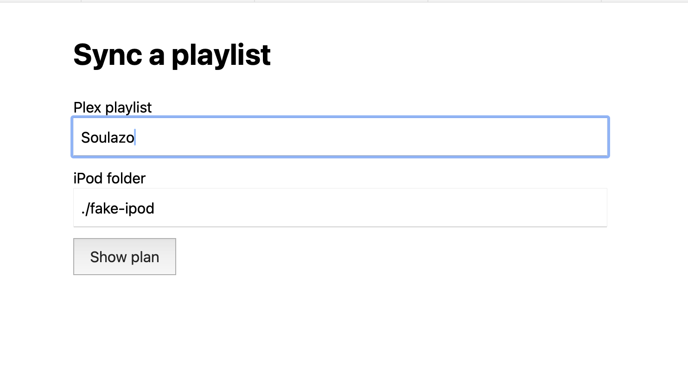
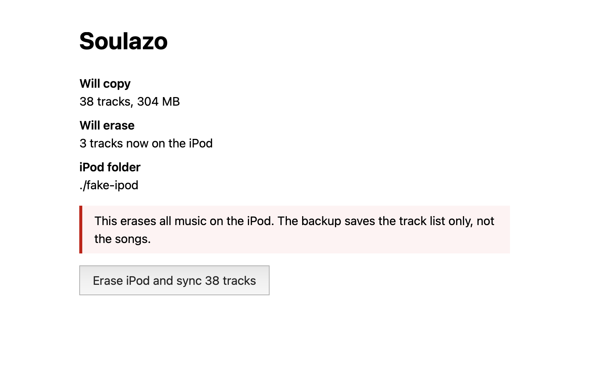
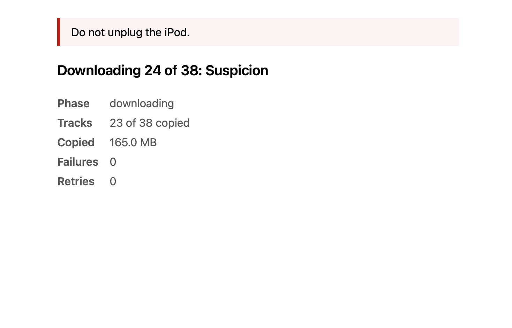
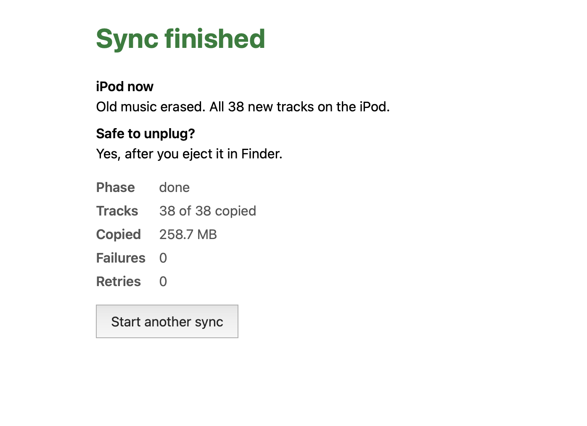

Con el avance de la IA, como ingeniero frontend veo que mi valor ya no está en escribir código, sino en lo que aporta valor a un producto y en cómo estructurar las soluciones para aportar ese valor. Una de esas cosas podría ser averiguar cómo hacer más fácil que las personas supervisen agentes de IA.

## La chispa: Cloudflare compra Deno

La noticia de que [Cloudflare ha comprado Deno](https://blog.cloudflare.com/deno-joins-cloudflare/) me hizo preguntarme por qué Cloudflare quería a ese equipo. Parece que sobre todo es por una tecnología llamada celld. Celld es la versión open source de Deno de Cloudflare Workers y Durable Objects: un único programa que puedes ejecutar en tus propios servidores, donde cada "celda" guarda su propio estado en su propia pequeña base de datos SQLite. Cloudflare planea integrarlo en workerd, su runtime open source, y mucha gente lo ve como una base para ejecutar agentes de IA.

La idea detrás de [Durable Objects](https://developers.cloudflare.com/durable-objects/) es que, en lugar de un gran servidor que guarda el estado de todo el mundo en una base de datos compartida, cada cosa tiene su propio objeto pequeño: uno por usuario, uno por chat, uno por tarea. Se levanta cuando llega un request, se duerme cuando nadie lo usa y recuerda su estado mientras duerme. Eso encaja bien con los agentes, porque el trabajo de un agente puede seguir ejecutándose y conservar su estado incluso después de cerrar la pestaña del navegador, y las sesiones pueden prolongarse a lo largo del tiempo.

## Bucear en el pasado en busca de soluciones

Ejecutar agentes crea problemas nuevos en la interfaz: necesitamos una forma de que el usuario sepa que existen estos procesos largos, en qué estado están, cuánto les falta para terminar y si han petado, y también pedirle aprobación a ese usuario cuando hay acciones destructivas.

Aprendo mucho de ver cómo se enfrentó la gente a problemas similares en el pasado. Buscando sobre el tema, encontré [el artículo de Bainbridge de 1983, Ironies of Automation](https://doi.org/10.1016/0005-1098(83)90046-8). Trata sobre control industrial, cosas como plantas químicas y aviones, pero el problema es el mismo que tenemos ahora: procesos largos que están automatizados pero que pueden necesitar intervención humana cuando algo se tuerce.

Bainbridge viene a decir que, cuando automatizas un proceso, la máquina se queda con las partes fáciles y a la persona le quedan las más difíciles. La persona ahora sobre todo observa, y solo interviene cuando algo sale mal. Ese es el peor momento para intervenir: tienes menos contexto que nunca, te falta práctica, y después de unos 30 minutos mirando ya nadie presta atención. La ironía es que cuanto más fiable es la automatización, peor se pone esto, porque los fallos son raros y la persona practica todavía menos.

Sus soluciones son hacer que los sistemas fallen de forma evidente en lugar de esconder los problemas en silencio, mostrar el estado para que una persona lo entienda de un vistazo cuando vuelve, no pedir a la gente que apruebe o compruebe cosas que no tiene forma de comprobar, y mantener a la persona en práctica para que todavía pueda tomar el control cuando importa.

## Divirtiéndome con cacharros antiguos, y haciendo como que investigo

Decidí reutilizar un proyecto mío que sincroniza mis listas de reproducción de [Plex](https://www.plex.tv) con mi iPod (sí, en 2026 un iPod vuelve a estar de moda, gracias enshittificación), porque el proceso de sincronización es parecido a lo que hacen los agentes. Plex es una aplicación de servidor multimedia que uso sobre todo para alojar y servir mi colección de MP3. También uso [Jellyfin](https://jellyfin.org), que es open source, y mi plan es que esto funcione también con Jellyfin más adelante.

Ya había creado [podscribe](https://github.com/menor/podscribe), una librería que permite subir música a un iPod porque sabe escribir la base de datos que usan los iPod. La uso mediante un script de línea de comandos que (por ahora) recibe como entrada el nombre de una lista de Plex, hace una copia de seguridad de la base de datos del iPod, borra el iPod, descarga los archivos de música, los sube al iPod y actualiza su base de datos interna.

Es un proceso que puede tardar un rato, así que era un buen candidato para ver cómo diseñar interfaces para este tipo de proceso. Cree podscribe como una librería externa porque la idea era tenerla funcionando algún día en una aplicación web local. Tiene que ser local: podscribe escribe archivos directamente en el iPod, y hasta donde yo se, no puedo hacer eso desde una web no local.

Después de pensarlo, la arquitectura para un MVP (producto mínimo viable) es esta:
  - El usuario introduce en el cliente el nombre de la lista y el directorio del iPod
  - El cliente envía una petición POST a `/jobs` con ambos datos
  - El servidor crea una tarea (nuestro durable object simplificado) que primero planifica, sin tocar el iPod:
    - Obtiene la lista de Plex y cuenta las canciones del iPod, a la vez
    - Muestra una vista previa: cuántas canciones, el tamaño total y cuántas canciones se van a borrar
    - Después se detiene y espera al usuario
  - Si el usuario aprueba (un POST a `/jobs/:id/approve`), la tarea:
    - Hace una copia de seguridad de la base de datos del iPod y borra el iPod
    - Descarga los archivos de música
    - Los sube al iPod y actualiza su base de datos

*Paso 1: eliges una lista y la carpeta del iPod. Todavía no se toca el iPod.*

*Paso 2: el plan. La tarea se detiene aquí hasta que apruebas, y el aviso dice lo que la copia de seguridad no puede deshacer.*

Lo interesante aquí fue el id de la tarea. El navegador escucha en `/jobs/:id/events`, y cada mensaje lleva el estado completo de la tarea. El primer mensaje siempre es el estado actual, así que la pantalla nunca está desactualizada.

*Durante la sincronización, cada mensaje lleva el estado completo, así que la pantalla es correcta incluso después de reconectar.*

Después puedes cerrar la pestaña del navegador, volver más tarde y ver el estado de la tarea. `/jobs/latest` vuelve a encontrar la tarea. Es el servidor quien es dueño de la tarea y de su estado.

*La pantalla final responde a lo que necesitas al volver: qué hay en el iPod y si es seguro desconectarlo.[^size]*

Una diferencia con un Durable Object de verdad: mi tarea vive en la memoria del servidor, así que si reinicio el servidor, la tarea desaparece. Un Durable Object conserva su estado incluso mientras duerme.

### Por qué Server-Sent Events y no WebSockets

Para enviar el estado de la tarea al navegador usé [Server-Sent Events](https://developer.mozilla.org/es/docs/Web/API/Server-sent_events) (SSE). El servidor mantiene abierta una respuesta HTTP y escribe un mensaje nuevo cada vez que la tarea cambia. En el lado del navegador es solo un `EventSource`.

WebSockets era la alternativa obvia, pero no encajaba:
  - **Las actualizaciones solo van en un sentido.** El servidor habla y el navegador escucha. El navegador solo envía 2 órdenes, crear la tarea y aprobarla, y para eso basta con un POST normal. WebSockets te da un canal en los dos sentidos que no necesitaba.
  - **SSE se reconecta solo.** Si se cae la conexión, el navegador la vuelve a abrir sin que yo escriba código. Con WebSockets tienes que escribir eso tú. Junto con la regla de que el primer mensaje siempre es el estado actual, reconectar simplemente funciona.
  - **Sin librerías extra.** SSE es HTTP normal, así que basta con el módulo `node:http` que trae Node. Node no trae un servidor de WebSockets, así que necesitaría una dependencia como `ws`.

Enviar el estado completo en cada mensaje, en lugar de solo lo que ha cambiado, también ayuda. Si el navegador se pierde un mensaje, el siguiente contiene toda la información.

Si más adelante añado pausar o cancelar, puedo mantener SSE y añadir un endpoint POST más para cada una.

## ¿Y qué tiene que ver todo esto del iPod con los agentes y los artículos antiguos?

Volví a Bainbridge y comparé sus soluciones con lo que estaba construyendo:
  - **Fallar de forma evidente.** Las descargas ya se reintentaban hasta 3 veces, pero en silencio. Solo te enterabas cuando fallaba el último intento. Ahora la aplicación cuenta los reintentos y te avisa de ellos, incluso cuando la sincronización termina bien.
  - **Entenderlo de un vistazo al volver.** Esto cambió mi plan. Iba a pulir la barra de progreso, pero el momento difícil no es ver la sincronización, es volver a ella, sobre todo cuando ha fallado. Así que le di prioridad a la pantalla final. Te dice si terminó o falló, por qué, cómo arreglarlo, qué hay ahora en el iPod y si es seguro desconectarlo.
  - **No pedir que se apruebe lo que no se puede comprobar.** Miré lo que hace de verdad la copia de seguridad: guarda la base de datos del iPod, pero el borrado sigue eliminando todos los archivos de audio. Así que la copia no puede deshacer un borrado, y ahora la pantalla de aprobación lo dice claramente.
  - **Mantener al humano implicado en el proceso.** Con esta todavía no he hecho nada.

Todavía es una versión muy básica, pero ha sido divertido explorarlo. Ya tiene una vista previa, un paso de aprobación y una pantalla final. Por ahora solo uso una carpeta de prueba y todavía no toco el iPod, pero quería escribir sobre esto antes de olvide. Habrá más sobre este tema. No tengo una demo publicada en ningún sitio, porque tendría que hacer pública mi biblioteca de Plex y todo el mundo descubriría los placeres culpables que tengo en mi música, como la [banda sonora de Xanadu](https://en.wikipedia.org/wiki/Xanadu_(soundtrack)) de ELO y Olivia Newton-John 😅

[^size]: Pendiente de arreglar: el plan dice 304 MB, pero la pantalla final dice 258.7 MB copiados. Los dos números deberían coincidir, o el plan debería indicar que su número es una estimación.
